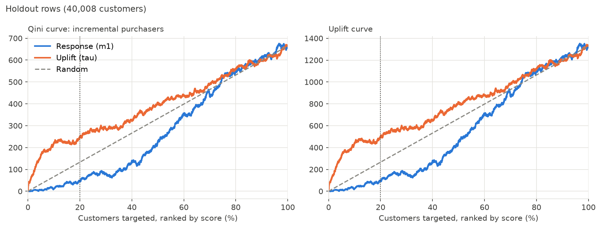
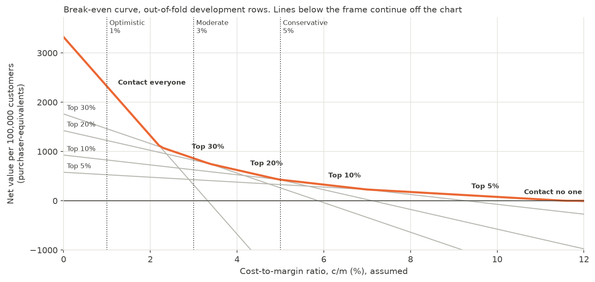

# Campaign Uplift Analysis: Who Should Receive the SMS?

If a retailer can message only some customers, should it pick the customers most likely to buy, or the customers whose buying the message changes most? This project answers that for an SMS campaign in the X5 RetailHero dataset. It compares **response targeting** (highest purchase likelihood) with **uplift targeting** (highest estimated effect of the SMS) on 200,039 labelled customers, then turns the result into a budget recommendation.

**Headline:** at a 20% contact budget, uplift targeting produced **+5.05 points** more uplift than response targeting (paired 95% interval +2.55 to +7.34). That is about **1,010 more extra purchasers per 100,000 customers** (+510 to +1,467). **Measured** on a holdout of 40,008 customers that was opened once, after the analysis was locked.

Observed checks are consistent with random assignment, but randomisation is not documented. Causal claims depend on that assumption.

## Question

- **H0:** at a 20% contact budget, uplift targeting produces no more incremental purchasers than response targeting.
- **H1:** it produces more.

The unit of value is **incremental purchasers**, meaning the treated purchase rate minus the control purchase rate. The data has no revenue outcome. Every number is labelled **Measured**, **Estimated from the model** or **Assumed**.

## Data

[X5 RetailHero uplift modelling](https://ods.ai/competitions/x5-retailhero-uplift-modeling/data) from ODS.ai: 400,162 clients, 45,786,568 purchase rows at product level, and 200,039 customers labelled with `treatment_flg` (SMS communication) and `target` (purchase in an undocumented period after communication). The unlabelled `uplift_test.csv` is read only for data validation checks.

## Method

| Phase | Notebook | What it does |
|---|---|---|
| 1. Experiment audit | `01_experiment_audit.ipynb` | Loads the raw CSVs to Parquet with DuckDB SQL and validates them. Checks the sample ratio, balance, a placebo outcome and leakage, sets the feature cutoff, estimates the campaign effect and creates a fixed 80/20 development/holdout split |
| 2. Features | `02_feature_engineering.ipynb` | Builds 39 pre-treatment customer features in DuckDB SQL (recency, frequency, spend, trend, basket, timing, loyalty points, client). Checks that the features cannot predict treatment |
| 3. Response model | `03_response_vs_uplift.ipynb` | XGBoost `m1(X) = P(purchase given X, treated)`, tuned on treated development customers by five-fold log-loss, with a fixed grid and a one-standard-error rule |
| 4. Uplift model | `03_response_vs_uplift.ipynb` | T-Learner: `m0` on control customers with the same setup, `tau(X) = m1(X) - m0(X)`. Out-of-fold scores for development, and holdout scores frozen by hash before evaluation |
| 5. Evaluation | `04_policy_evaluation.ipynb` | Uplift@K, Qini and AUUC, with a paired, arm-stratified bootstrap (2,000 resamples). Disagreement analysis, and six predefined RFM segments with Benjamini-Hochberg correction. The holdout was evaluated once, after lock commit `8c468b5` |
| 6. Recommendation | `05_business_recommendations.ipynb` | Net value under assumed cost-to-margin ratios, a break-even curve and the [decision memo](reports/decision_memo.md) |

The rules for each phase were committed to [`reports/decisions.md`](reports/decisions.md) before that phase's results existed. The log records every departure from the original plan, and the evidence behind each choice. Shared selection and evaluation code is in `notebooks/targeting.py`.

## Results

### Campaign effect

Purchase rate 63.65% treated against 60.33% control, a difference of **+3.32 points** (95% CI +2.90 to +3.75), on all 200,039 customers. **Measured.** Before that, the audit found:
- a 49.98% treated share (p = 0.86)
- no standardised mean difference above 0.013
- a placebo difference of +0.05 points (−0.24 to +0.34)
- a treatment-prediction AUC below 0.52, with every interval including 0.50

`first_redeem_date` contains post-treatment information, so it is excluded from all models.

### Targeting strategies on the holdout

Uplift@K in points, with 95% intervals. **Measured.** The 20% comparison is the only pre-registered primary result. The other budgets are secondary, and 5% is exploratory.

| Budget | Random (expected) | Response | Uplift | Uplift minus response |
|---:|---:|---:|---:|---:|
| 5% | +3.32 | +0.54 (−0.63 to +1.89) | +16.24 (+11.87 to +20.39) | +15.70 (+11.18 to +20.04) |
| 10% | +3.32 | +0.61 (−0.63 to +1.79) | +11.02 (+7.81 to +13.98) | +10.41 (+6.88 to +13.51) |
| **20%** | +3.32 | +1.21 (+0.10 to +2.40) | +6.26 (+3.99 to +8.35) | **+5.05 (+2.55 to +7.34)** |
| 30% | +3.32 | +1.36 (+0.23 to +2.43) | +4.75 (+2.94 to +6.50) | +3.39 (+1.33 to +5.31) |

- **Uplift beats response:** the paired interval at 20% lies entirely above zero, so under the pre-set rule **uplift targeting performed better at the 20% budget**. The development view agrees in direction at every budget.
- **Response loses to random:** response targeting did worse than random targeting at every budget. Customers most likely to buy mostly buy anyway.
- **Segments:** all six RFM segments show a positive campaign effect after correction, from +1.33 to +4.34 points.



### Budget recommendation

Net value is extra purchasers minus SMS cost, in units of one purchaser's margin, per 100,000 customers. The cost-to-margin ratio `c/m` is **Assumed**, because the data has no costs or margins. Each choice is the best locked budget on development data, and the holdout value is shown beside it.

| c/m (Assumed) | Who to contact | Net value, development | Net value, holdout | Note |
|---|---|---:|---:|---|
| 1% | Everyone | +2,323 (+1,857 to +2,782) | +2,324 (+1,319 to +3,274) | |
| 3% | Top 30% by estimated uplift | +862 (+580 to +1,119) | +524 (−17 to +1,049) | Close call with top 20%. The holdout ranks top 10% higher |
| 5% | Top 10% by estimated uplift | +428 (+278 to +582) | +602 (+281 to +898) | Close call with top 20% |

Contacting everyone is best only while `c/m` is below 2.23%. Above that, the best budget shrinks: top 30% up to 3.38%, top 20% up to 4.96%, top 10% up to 6.99% and top 5% up to 11.57%. Above 11.57%, contact no one.



## Limitations

- **Assignment:** randomisation is not documented, and `treatment_flg` may record assignment or delivery. The 596 MB organiser archive was not checked.
- **Outcome:** a purchase in an undocumented period, not revenue or margin. Opt-outs, message fatigue and long-term effects are not observed.
- **Precision:** intervals cover sampling noise in the evaluation, not refitting the models. Only the 20% comparison carries a conclusion.
- **Individuals:** results compare targeting rules on groups. They do not identify individual persuadable customers.
- **Scope:** the labelled cohort only, with 118 days of purchase history. Cost scenarios are assumptions.

## Future work

- **Product features:** category spend shares and brand counts, left out in Phase 2 (see the decisions log).
- **Ranking stability:** score the holdout with the five fold model pairs, to measure how much `tau` rankings move with the training rows.
- **Field test:** a randomised test of "top K% by estimated uplift" against contacting everyone or random targeting, with revenue tracked and a documented outcome window.

## How to rerun

1. **Environment:** Python 3.13, then `python -m venv venv`, activate it, and `pip install -r requirements.txt`. The requirements include `ipykernel` but no Jupyter front end, so open the notebooks in VS Code or install JupyterLab separately.
2. **Data:** download `clients.csv`, `products.csv`, `purchases.csv`, `uplift_train.csv` and `uplift_test.csv` (used only for row-count and overlap checks) from the [ODS.ai data page](https://ods.ai/competitions/x5-retailhero-uplift-modeling/data) into `data/raw/` (about 4.4 GB).
3. **Run:** run `notebooks/01` to `05` in order, from the `notebooks/` folder or the project root. Each notebook writes the Parquet files the next one reads to `data/processed/`, and the refit models to `models/`. Both folders are ignored by Git.
4. **Time and memory:** about 32 minutes in total on the author's machine, mostly notebooks 03 and 04. DuckDB is capped at 5 GB, so close memory-heavy applications first.

The notebooks stop rather than continue if a result drifts:
- The split must match its recorded SHA-256.
- The holdout scores must match the freeze hash.
- Notebook 05 checks the saved Phase 5 tables against their recorded hashes.

`outputs/tables/holdout_scores_reference.csv` holds label-free, ID-free model scores and serves as the holdout freeze record.

**Clean rerun, 2026-11-08:** a fresh virtual environment built from `requirements.txt` ran all five notebooks from the raw files without a failed check.
- **Identical:** the split, labels, out-of-fold scores and holdout scores were exactly identical to the earlier run, and both freeze checks matched the recorded hash. Every result table and every figure was byte-identical.
- **Small differences:** seven descriptive tables differed only in trailing floating-point digits. The feature values differ by at most 1.75e-10, most likely because summation order changes in DuckDB's parallel aggregation. No value quoted in the decisions log changed.

## Repository

```text
├── sql/                   DuckDB load, validation and feature SQL
├── notebooks/             01-05 and targeting.py (shared selection and evaluation rules)
├── outputs/tables/        CSV results
├── outputs/figures/       Charts
├── reports/decisions.md   Pre-registered rules, evidence and results, phase by phase
├── reports/decision_memo.md  One-page recommendation for a non-technical reader
└── requirements.txt       Pinned direct dependencies
```
